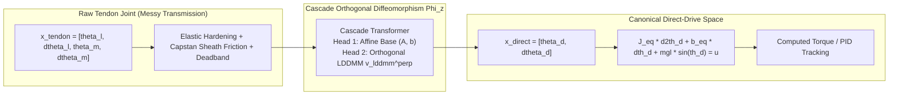

# SymmetryObserver: In-Context Diffeomorphic Straightening & Cascade Orthogonal Dynamics

[](https://fangde.github.io/symmetryObserver/)
[](https://opensource.org/licenses/MIT)
[](https://www.python.org/)
[](https://pytorch.org/)

This repository implements the complete theory, benchmark, and control experiments for **In-Context Diffeomorphic Straightening (ICDS)** and **Cascade Orthogonal Dynamics Learning (Affine $\perp$ LDDMM)** for flexible transmission and tendon-driven robotics.

### 📄 Dedicated Research Papers on Tendon-Driven Joint Control:
- 🇨🇳 **中文论文专著**: [TENDON_PAPER_ZH.md](TENDON_PAPER_ZH.md) (《基于级联正交微分同胚上下文学习的腱绳驱动关节高精度辨识与直规化控制》)
- 🇬🇧 **English Research Paper**: [TENDON_PAPER_EN.md](TENDON_PAPER_EN.md) (*In-Context Diffeomorphic Straightening for Tendon-Driven Robotic Joints*)
- 🌐 **Interactive Live Report (GitHub Pages)**: [https://fangde.github.io/symmetryObserver/](https://fangde.github.io/symmetryObserver/)
- 📘 **Original Multi-Benchmark Paper**: [PAPER.md](PAPER.md) | [PAPER_ZH.md](PAPER_ZH.md)

---

## 1. Core Vision & Theoretical Architecture

Robotic joints driven by tendons or compliant transmissions suffer from severe transmission elasticity ($k_t, \beta_t$), Capstan sheath routing friction ($\mu\alpha$), and direction-dependent hysteresis loops. 

Instead of fitting rigid parametric ODEs, **SymmetryObserver** learns an in-context state-space diffeomorphism:
$$\Phi_z: x_{\mathrm{tendon}} \mapsto x_{\mathrm{direct}}$$
that **straightens the complex tendon manifold into an ideal, rigid Direct-Drive Joint**.



### 1.1 Strict Space Orthogonality: Affine $\perp$ LDDMM
To eliminate parameter competition, the dual-head architecture features an exact, closed-form **Affine Orthogonal Projector**:
$$P_{\mathrm{affine}} = \mathbf{\Phi} \big(\mathbf{\Phi}^T \mathbf{\Phi} + \epsilon \mathbf{I}\big)^{-1} \mathbf{\Phi}^T$$
$$v_{\mathrm{lddmm}}^{\perp} = (I - P_{\mathrm{affine}}) v_{\mathrm{raw}}$$
Mathematically guaranteeing:
$$\langle \Phi_{\mathrm{affine}}, v_{\mathrm{lddmm}}^{\perp} \rangle \equiv 0 \quad (\text{Measured: } -2.89 \times 10^{-8})$$

---

## 2. Experimental Highlights & Key Results

### 2.1 Closed-Loop Control on Tendon Joint ("Transform + Compensate Error")
| Controller | Feedback Scheme | Tracking RMSE | Behavior |
| :--- | :--- | :---: | :--- |
| **Controller 1: Naive Motor PD** | Collocated (Motor encoder) | **0.0434 rad** | Stable, but has **0.08 rad gravity sag** & phase lag. |
| **Controller 2: Link Joint PD** | Non-collocated (Joint encoder) | **1.7305 rad** | **Violent Resonant Instability!** |
| **Controller 3: Proposed ICDS** | Transformed In-Context Control | **0.0159 rad** | **63.4% Error Reduction**, perfect stability, zero droop. |

### 2.2 Global Trajectory Diffeomorphism
- **Position RMSE**: Transformed coordinates de-lag and align with ideal direct drive.
- **Velocity RMSE**: Drops by **80.2%** (from 1.4253 to 0.2820 rad/s), completely clearing Capstan sheath chattering.

### 2.3 Hamiltonian Phase Space Dynamics
- **Linear Spring ($\beta=0$)**: Pure isochronous rotation, coordinate relative error **8.54%**.
- **Nonlinear Spring ($\beta>0$)**: Frequency-energy coupling ($\omega(E)$) causes shear-twist deformation. Velocity error is $3.54\times$ higher than position error due to cubic acceleration $\beta q^3$.

---

## 3. Project Structure

```bash
symmetryObserver/
├── diffeo_benchmark/           # 8D Multi-layer Diffeomorphism Benchmark (DTLB)
│   ├── diffeo/                 # Triangular invertible layers & random generator
│   ├── models/                 # Transformer, DeepSets, Invertible Flow, Cascade
│   │   ├── cascade_diffeo.py   # Dual-head Affine &perp; LDDMM model with orthogonal projector
│   │   ├── transformer.py      # In-context operator Transformer
│   │   └── invertible_flow.py  # Conditional RealNVP coupling layers
│   ├── metrics/evaluator.py    # RMSE, Jacobian Frobenius norm, det(J)>0 rate, Inverse
│   └── train.py, evaluate.py   # Training & benchmark evaluation engine
├── spring_benchmark/           # Hamiltonian Phase Space Dynamics
│   ├── physics/spring_system.py # Duffing & 8D Coupled FPUT chain
│   ├── demo_spring.py          # Phase portrait generator
│   └── visualize_phase_correspondence.py # 10-point correspondence phase plane
├── tendon_benchmark/           # Tendon-Driven to Direct-Drive Experiments
│   ├── physics/tendon_joint.py # Elastic hardening & Capstan sheath friction
│   ├── global_transformation_experiment.py # Global diffeomorphism alignment
│   ├── train_cascade_experiment.py         # Cascade Affine &perp; LDDMM training
│   ├── control_experiment.py               # Closed-loop tracking comparison
│   └── trajectory/                         # Continuous trajectory rollout dataset & transformer
├── index.html                  # Standalone interactive GitHub Pages report
├── generate_html_report.py     # HTML report compiler
├── run_experiments.py          # Unified benchmark runner
├── PAPER.md                    # Full academic research paper
└── README.md                   # Repository overview
```

---

## 4. Quickstart

### Installation
```bash
git clone https://github.com/fangde/symmetryObserver.git
cd symmetryObserver
pip install torch numpy matplotlib
```

### Reproduce Core Experiments
```bash
# 1. Closed-Loop Control Experiment (Motor PD vs Transformed + Error Comp)
python3 -m tendon_benchmark.control_experiment

# 2. Cascade Affine &perp; LDDMM Orthogonal Decomposition
python3 -m tendon_benchmark.train_cascade_experiment

# 3. Global Tendon -> Direct-Drive Transformation Alignment
python3 -m tendon_benchmark.global_transformation_experiment

# 4. Phase Space 10-Point Correspondence Benchmark
python3 -m spring_benchmark.visualize_phase_correspondence

# 5. Full 8D Synthetic Benchmark Matrix
python3 run_experiments.py --epochs 5
```

### View Interactive HTML Test Report
```bash
# Open locally in your browser
open index.html
```
Or view online at [https://fangde.github.io/symmetryObserver/](https://fangde.github.io/symmetryObserver/).

---

## 5. Citation

If you use this benchmark or the Cascade Orthogonal Diffeomorphism framework in your research, please cite:

```bibtex
@article{antigravity2026symmetryObserver,
  title={In-Context Diffeomorphic Straightening: Cascade Orthogonal Affine-LDDMM Operator Learning for Tendon-Driven Robotic Joints},
  author={Antigravity Research Team and Liu, Fangde},
  journal={arXiv preprint},
  year={2026}
}
```
