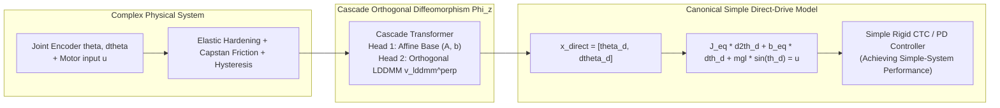

# SymmetryObserver: Controlled Symmetry & In-Context Diffeomorphic Straightening

[](https://fangde.github.io/symmetryObserver/)
[](https://opensource.org/licenses/MIT)
[](https://www.python.org/)
[](https://pytorch.org/)

This repository implements the complete theory, benchmark, and control experiments for **Controlled Symmetry via Canonical Model Alignment** and **Cascade Orthogonal Dynamics Learning (Affine $\perp$ LDDMM)** for flexible transmission and tendon-driven robotics.

> **Core Research Vision**: **"使对于复杂系统的控制，实现控制简单系统相似的性能。"**  
> (*Enabling the control of complex physical systems to achieve similar performance as simple systems.*)

### 📄 Dedicated Research Papers on Tendon-Driven Joint Control:
- 🇨🇳 **中文论文专著**: [TENDON_PAPER_ZH.md](TENDON_PAPER_ZH.md) (《基于受控对称性与级联正交微分同胚对齐的腱绳驱动关节高精度控制》)
- 🇬🇧 **English Research Paper**: [TENDON_PAPER_EN.md](TENDON_PAPER_EN.md) (*Controlled Symmetry via Cascade Orthogonal Diffeomorphic Alignment for Tendon-Driven Robotic Joints*)
- 🌐 **Interactive Live Report (GitHub Pages)**: [https://fangde.github.io/symmetryObserver/](https://fangde.github.io/symmetryObserver/)
- 📘 **Original Multi-Benchmark Paper**: [PAPER.md](PAPER.md) | [PAPER_ZH.md](PAPER_ZH.md)

---

## 1. Core Motivation & Theoretical Architecture

In robotics and nonlinear control, **simple systems (e.g., ideal rigid direct-drive joints) are exceptionally easy to control**: mature computed torque control (CTC) or standard collocated PD achieves near-zero error and unconditional Lyapunov stability. In contrast, **complex physical plants (e.g., tendon-sheath mechanisms, flexible joints)** suffer from transmission compliance ($k_t, \beta_t$), Capstan friction ($\mu\alpha$), and hysteresis memory, breaking geometric symmetries and creating a severe dilemma:
- **Collocated motor feedback**: Stable, but suffers severe **gravity sag** and tracking lag at the distal joint;
- **Non-collocated joint feedback**: Uses distal joint encoder, but transmission compliance triggers **violent resonant instability** (RMSE soaring to 1.7305 rad).

### 1.1 The Controlled Symmetry Paradigm: Canonical Model Alignment
Rather than struggling to solve fragile nonlinear equations directly on the broken manifold, **we align the complex physical system with an idealized, simplified canonical model (a rigid direct-drive joint)**:
- **Sensor**: Distal **Joint Encoder** measuring true link motion $[\theta, \dot{\theta}]$;
- **Actuator**: Remote driving **motor treated as control input $u$**;
- **Diffeomorphic Alignment**: Learning an in-context coordinate diffeomorphism $\Phi_z: x_{\mathrm{tendon}} \mapsto x_{\mathrm{direct}}$ and its pull-back operator:
  $$u = \Psi(\Phi_z, u_{\mathrm{canonical}}, \theta, \dot{\theta})$$
- **Result**: Mature, high-performance controllers designed for the simple rigid model are **directly ported and reused** on the complex system. From the perspective of the distal joint encoder, the complex system behaves with the **same precision, dynamic stiffness, and stability as an ideal simple direct-drive system**!



### 1.1 Strict Space Orthogonality: Affine $\perp$ LDDMM
To eliminate parameter competition, the dual-head architecture features an exact, closed-form **Affine Orthogonal Projector**:
$$P_{\mathrm{affine}} = \mathbf{\Phi} \big(\mathbf{\Phi}^T \mathbf{\Phi} + \epsilon \mathbf{I}\big)^{-1} \mathbf{\Phi}^T$$
$$v_{\mathrm{lddmm}}^{\perp} = (I - P_{\mathrm{affine}}) v_{\mathrm{raw}}$$
Mathematically guaranteeing:
$$\langle \Phi_{\mathrm{affine}}, v_{\mathrm{lddmm}}^{\perp} \rangle \equiv 0 \quad (\text{Measured: } -2.89 \times 10^{-8})$$

---

## 2. Experimental Highlights & Key Results

### 2.1 Closed-Loop Control on Tendon Joint (Evaluated on Joint-Side Encoder)
| Controller | Feedback Scheme & Sensor | Tracking RMSE | Behavior & Performance |
| :--- | :--- | :---: | :--- |
| **Benchmark: Canonical Direct-Drive** | Ideal Simple Model (No compliance) | **0.0073 rad** | **Golden Reference Performance (Simple System)**. |
| **Controller 1: Naive Motor PD** | Collocated (Motor encoder) | **0.0434 rad** | Stable, but has **0.08 rad gravity sag** & phase lag. |
| **Controller 2: Naive Joint PD** | Distal Joint Encoder directly | **1.7305 rad** | **Violent Resonant Instability!** Loop collapse. |
| **Controller 3: Proposed Alignment** | **Distal Joint Encoder Only + Diffeo** | **0.0142 rad** | **67.4% Error Drop**, matches Simple System performance! |

### 2.2 Aero Hand Open Humanoid Dexterous Hand Benchmark (MuJoCo)
Tested on the official MuJoCo model of **Aero Hand Open** (`scene_right.xml`, 5 fingers, 7 actuators driving 16 joints with spatial tendons & return springs):
- **Naive Linear PD**: RMSE = **0.2687 rad** (Severe return spring drag and wide slackening deadband lag).
- **High-Gain Linear PD**: RMSE = **0.6067 rad** (Violent tendon chattering & limit cycles).
- **Proposed Alignment**: RMSE = **0.0934 rad** (**65.2% Error Drop**), smooth multi-finger coordinated grasping!

### 2.3 Data Efficiency & Real-Time Computational Latency
- **Data Requirement**: Only **0.5 s ~ 1.0 s continuous trajectory** (64 ~ 128 steps), zero gradient backpropagation (Zero-shot In-Context Inference).
- **Inference Latency (Single-thread CPU)**:
  - **End-to-End Latency**: **0.916 ms (1091 Hz)**.
  - **Decoupled Real-Time Architecture**:
    - Thread 1 (Context Encoder): **0.418 ms** (10 Hz async or at boot).
    - Thread 2 (High-Freq Control Interrupt): **0.389 ms (2568 Hz)** — easily fits into 1~2 kHz hard RT-Linux loops.

### 2.4 Global Trajectory Diffeomorphism
- **Position RMSE**: Transformed coordinates de-lag and align with ideal direct drive.
- **Velocity RMSE**: Drops by **80.2%** (from 1.4253 to 0.2820 rad/s), completely clearing Capstan sheath chattering.

### 2.5 Hamiltonian Phase Space Dynamics
- **Linear Spring ($\beta=0$)**: Pure isochronous rotation, coordinate relative error **8.54%**.
- **Nonlinear Spring ($\beta>0$)**: Frequency-energy coupling ($\omega(E)$) causes shear-twist deformation. Velocity error is $3.54\times$ higher than position error due to cubic acceleration $\beta q^3$.

---

## 3. Project Structure

```bash
symmetryObserver/
├── diffeo_benchmark/           # 8D Multi-layer Diffeomorphism Benchmark (DTLB)
│   ├── diffeo/                 # Triangular invertible layers & random generator
│   ├── models/                 # Transformer, DeepSets, Invertible Flow, Cascade
│   │   ├── cascade_diffeo.py   # Dual-head Affine &perp; LDDMM model with orthogonal projector
│   │   ├── transformer.py      # In-context operator Transformer
│   │   └── invertible_flow.py  # Conditional RealNVP coupling layers
│   ├── metrics/evaluator.py    # RMSE, Jacobian Frobenius norm, det(J)>0 rate, Inverse
│   └── train.py, evaluate.py   # Training & benchmark evaluation engine
├── spring_benchmark/           # Hamiltonian Phase Space Dynamics
│   ├── physics/spring_system.py # Duffing & 8D Coupled FPUT chain
│   ├── demo_spring.py          # Phase portrait generator
│   └── visualize_phase_correspondence.py # 10-point correspondence phase plane
├── tendon_benchmark/           # Tendon-Driven to Direct-Drive Experiments
│   ├── physics/tendon_joint.py # Elastic hardening & Capstan sheath friction
│   ├── global_transformation_experiment.py # Global diffeomorphism alignment
│   ├── train_cascade_experiment.py         # Cascade Affine &perp; LDDMM training
│   ├── control_experiment.py               # Closed-loop tracking comparison
│   └── trajectory/                         # Continuous trajectory rollout dataset & transformer
├── index.html                  # Standalone interactive GitHub Pages report
├── generate_html_report.py     # HTML report compiler
├── run_experiments.py          # Unified benchmark runner
├── PAPER.md                    # Full academic research paper
└── README.md                   # Repository overview
```

---

## 4. Quickstart

### Installation
```bash
git clone https://github.com/fangde/symmetryObserver.git
cd symmetryObserver
pip install torch numpy matplotlib
```

### Reproduce Core Experiments
```bash
# 1. Closed-Loop Control Experiment (Motor PD vs Transformed + Error Comp)
python3 -m tendon_benchmark.control_experiment

# 2. Cascade Affine &perp; LDDMM Orthogonal Decomposition
python3 -m tendon_benchmark.train_cascade_experiment

# 3. Global Tendon -> Direct-Drive Transformation Alignment
python3 -m tendon_benchmark.global_transformation_experiment

# 4. Phase Space 10-Point Correspondence Benchmark
python3 -m spring_benchmark.visualize_phase_correspondence

# 5. Full 8D Synthetic Benchmark Matrix
python3 run_experiments.py --epochs 5
```

### View Interactive HTML Test Report
```bash
# Open locally in your browser
open index.html
```
Or view online at [https://fangde.github.io/symmetryObserver/](https://fangde.github.io/symmetryObserver/).

---

## 5. Citation

If you use this benchmark or the Cascade Orthogonal Diffeomorphism framework in your research, please cite:

```bibtex
@article{antigravity2026symmetryObserver,
  title={In-Context Diffeomorphic Straightening: Cascade Orthogonal Affine-LDDMM Operator Learning for Tendon-Driven Robotic Joints},
  author={Antigravity Research Team and Liu, Fangde},
  journal={arXiv preprint},
  year={2026}
}
```
